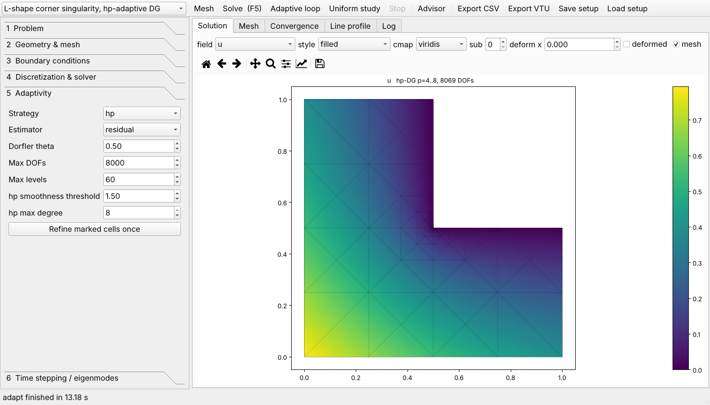
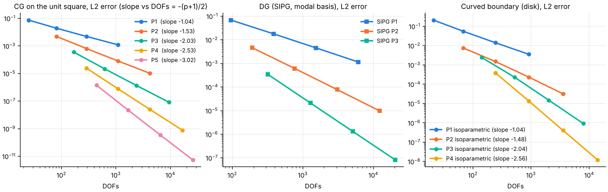
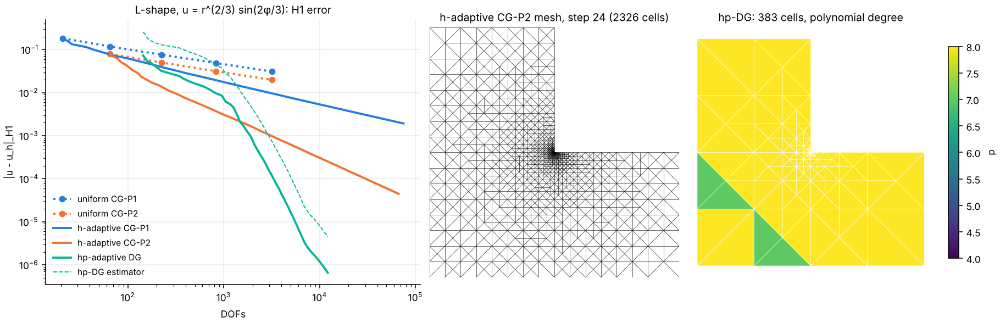
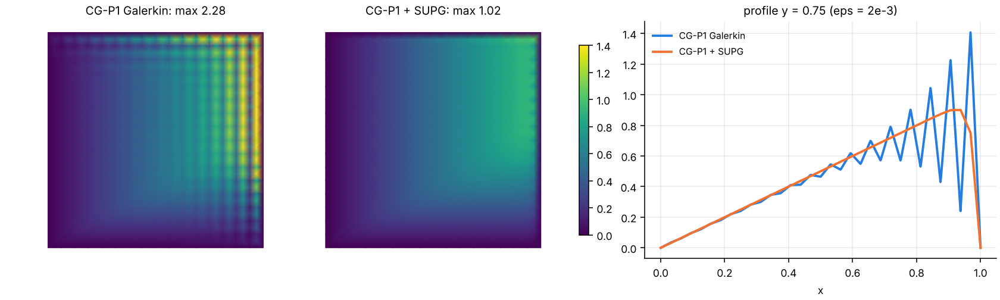
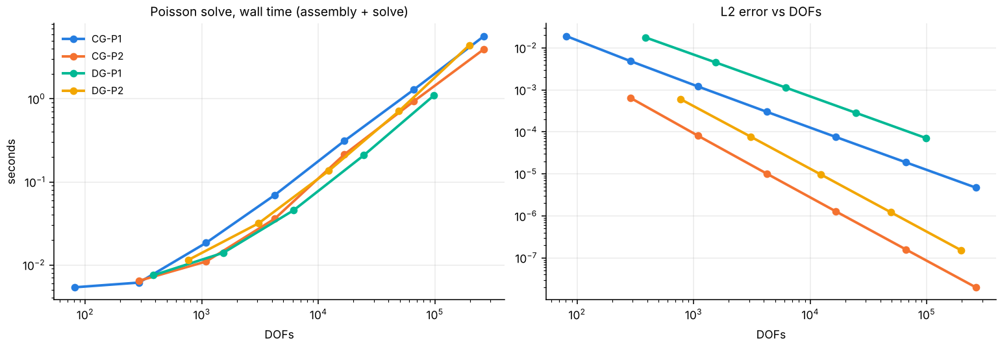
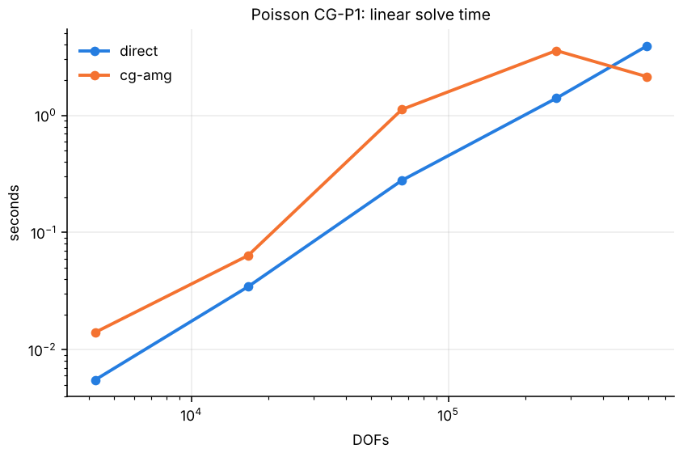
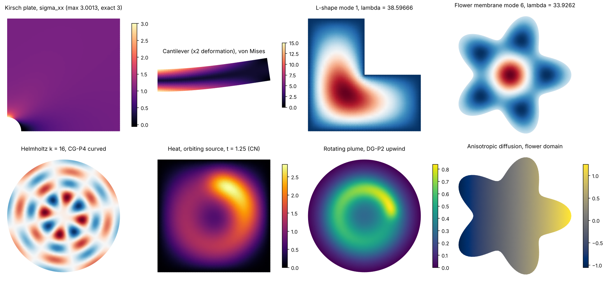
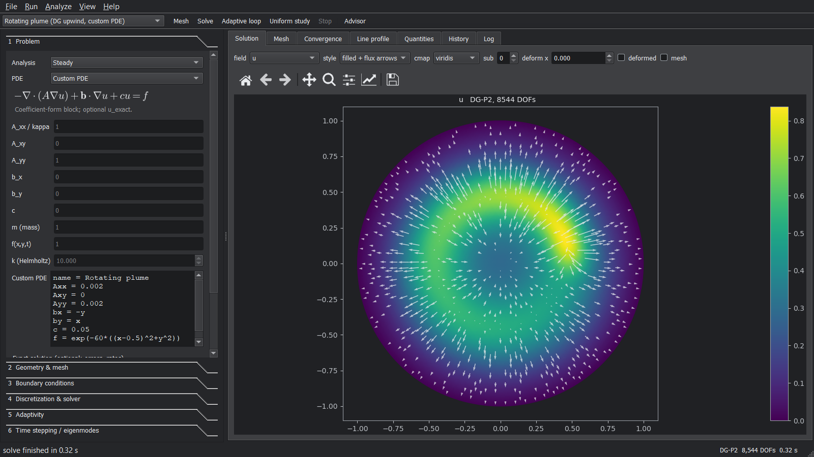
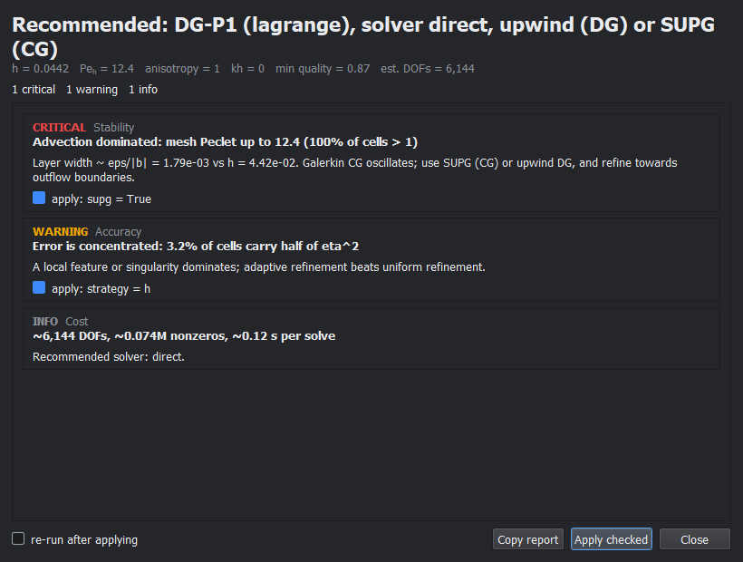
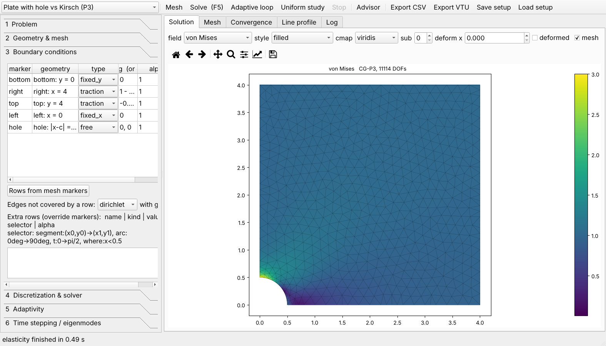

# FEM Toolbox

I had taken an FEM class in the UCONN MATH department in the Spring of 2025 and really enjoyed it. Since then I've tried to read more of the literature on it and the more SOTA approaches. It started as a way to try out high-order and hp methods, but just kept growing as I read more papers: continuous and discontinuous Galerkin up to degree 8, curved boundaries, adaptive refinement, nonlinear, transient and eigenvalue solvers, and an advisor that looks at a problem and tells you what is likely to go wrong before you solve it. Everything is vectorized NumPy/SciPy, and there is a PyQt GUI on top.



## Install and run

1. Clone the repository and install the requirements.

   ```bash
   git clone https://github.com/gaschenb/FEM-Toolbox.git
   cd FEM-Toolbox
   pip install -r requirements.txt
   pip install -e .
   ```

2. Open the GUI with `fem-toolbox` (or `python -m femtoolbox`).
3. Rebuild every figure in this README with `python -m femtoolbox.examples.gallery docs/figures`.

It runs on Windows and Linux with Python 3.10 or newer. The dependencies are numpy, scipy, matplotlib, pyamg and PyQt5.

## Features

1. Linear PDEs of the form −∇·(A∇u) + b·∇u + cu = f, where A, b, c and f can all vary in space and time. Poisson, diffusion, reaction-diffusion, advection-diffusion, Helmholtz and heat are built in, and you can type in any other coefficient set.
2. Nonlinear PDEs. Any coefficient can depend on u, ∂u/∂x and ∂u/∂y.
3. Continuous Galerkin and hp discontinuous Galerkin, P0 to P8, with nodal or modal bases.
4. Curved boundaries with isoparametric cells.
5. Built-in domains (square, rectangle, L-shape, disk, annulus, plate with a hole, polygons, parametric curves) and Gmsh mesh import and export.
6. h- and hp-adaptive refinement driven by a posteriori error estimators.
7. SUPG stabilization for advection-dominated problems.
8. Direct, algebraic multigrid and Krylov solvers, picked automatically by problem size and symmetry.
9. Time stepping with θ-schemes, Rannacher start-up and BDF2.
10. Eigenvalue problems.
11. Plane stress and plane strain elasticity, with von Mises stress and deformed shapes.
12. Dirichlet, Neumann and Robin conditions, picked by boundary marker, segment, arc angle, arclength or an expression.
13. Post-processing: norms, energy, min and max with location, boundary fluxes per marker with a global balance check, and integrals you type in yourself over the domain or the boundary.
14. Export to CSV, VTU (ParaView) and Gmsh.
15. An advisor that checks the setup and the solution and suggests fixes you can apply with one click.

## Methods

1. **Discretization.** The weak form and the CG convergence theory follow Brenner and Scott [1]. The DG part uses interior penalty (SIPG, NIPG, IIPG) as analysed by Arnold, Brezzi, Cockburn and Marini [2], with upwind fluxes for advection and Nitsche's method for Dirichlet data [3]. The modal basis is the L2-orthonormal Dubiner basis on triangles [4], which makes per-cell p easy and gives a cheap smoothness indicator.
2. **Geometry and meshes.** Meshes come from a boundary-fitted DistMesh [5] or from Gmsh [6]. Boundary pieces keep their labels through refinement. Curved cells use isoparametric blending of edge bubbles, so the optimal rate survives on curved domains [7].
3. **Refinement.** h-refinement uses newest-vertex bisection with closure [8]. New boundary nodes are projected onto the exact curve.
4. **Error estimation and adaptivity.** I use the residual estimator with hp scaling and DG jump terms [9] and Zienkiewicz–Zhu gradient recovery [10], with Dörfler marking [11]. For hp, a cell is p-enriched when its modal coefficients decay fast and h-refined otherwise [12]. On singular problems this gives exponential convergence [13].
5. **Stabilization.** SUPG uses the classic coth formula for τ [14].
6. **Linear solvers.** Small and medium problems go to SuperLU [15]. Large symmetric problems go to AMG-preconditioned CG through PyAMG [16], and nonsymmetric ones go to ILU-preconditioned GMRES or BiCGStab [17].
7. **Nonlinear solvers.** When only c or f depends on u, I use Newton's method with a finite-difference linearization of the coefficients, which converges quadratically [18]. When A or b depends on u, I use Picard iteration with relaxation. Transient nonlinear problems use a linearly implicit θ-scheme with lagged coefficients.
8. **Time stepping.** The time stepping covers the θ-scheme (backward Euler and Crank–Nicolson), Rannacher start-up for non-smooth initial data [19] and BDF2 [20]. Factorizations are reused between steps.
9. **Eigenproblems.** These are solved with shift-invert Lanczos through ARPACK [21].
10. **Boundary fluxes.** For CG, fluxes come from the residual of the assembled system rather than from differentiating u_h. This makes them conservative, so ∫f − ∫cu − ∮flux balances to round-off [22].
11. **Advisor.** Each check is grounded in a known result:
    1. corner and mixed-boundary singularities and their exponent α [23];
    2. the mesh Péclet number [14];
    3. Helmholtz points per wavelength and pollution error, where it chooses p so that k(kh/2p)^(2p) stays small [24, 25];
    4. volumetric and shear locking in elasticity [26];
    5. Crank–Nicolson stiffness [19];
    6. eigenmode resolution from Weyl's law [27].

## Results/Examples

1. **Convergence.** CG reaches the optimal rates, L2 ~ h^(p+1) and H1 ~ h^p, from P1 to P5, and SIPG does the same from P1 to P3 [1, 2]. On the disk the isoparametric cells keep the optimal rate through P5. Straight-sided cells would cap it at h².

   

2. **Adaptivity on the L-shape** with u = r^(2/3) sin(2φ/3). h-adaptive CG-P2 reaches an H1 error of 3.4e-4 with 9,163 DOFs. hp-adaptive DG reaches 2.1e-6 with about 8,000 DOFs, which is exponential convergence [13]. The residual estimator's effectivity stays between 4.8 and 5.5 under refinement.

   

3. **Validation against known answers.**

   | problem | result |
   |---|---|
   | L-shape first Dirichlet eigenvalue, reference 38.5589 [28] | 38.5739 (P3, n = 32) |
   | disk eigenvalues, P4 | relative error 3.6e-9 |
   | Kirsch plate, stress concentration factor 3 [29] | 3.00002 (P4) |
   | Timoshenko cantilever [30], P3 | exact to 1e-12 (P1 locks [26]) |
   | time order of BE / CN / BDF2 / Rannacher | 1 / 2 / 2 / 2 |
   | boundary layer, ε = 2e-3, P1 | Galerkin overshoots to 2.28, SUPG to 1.02 [14] |
   | Bratu problem, λ = 1, P2 [31] | max u = 0.078101 in 3 Newton steps |
   | nonlinear diffusion κ = 1 + u², P2 | L2 rate 3 |
   | flux balance on an annulus | 1e-14 |

   

4. **Speed.** Poisson on the unit square, assembly plus solve: 263k DOFs at P1 with AMG-CG in 5.7 s, and 66k DOFs at P4 in 0.74 s. The direct solver wins below about 10^5 DOFs and AMG-CG scales linearly beyond that, so `solver="auto"` switches at 250k.

   

   

5. **Gallery.**

   

## GUI

1. Pick one of the 15 examples from the dropdown, or set up your own problem in the side panel: PDE, geometry and mesh, boundary conditions, discretization and solver, adaptivity, and time stepping or eigenmodes.
2. Run with Solve (F5), Adaptive loop (F6) or Uniform study (F7). Solves run in the background and can be stopped with Esc.
3. The tabs show:
   1. the solution, as filled, contour, 3D surface or flux-arrow plots;
   2. the mesh with its quality histogram;
   3. the convergence history;
   4. line profiles;
   5. quantities and boundary fluxes;
   6. the history (time series at a probe point, the spectrum against Weyl's law, or the nonlinear iterations);
   7. the log.
4. Click a point on the plot to probe it, and shift-click two points to take a line profile. Zooming out stops at the full extent of the plot.
5. The advisor (F8) ranks what it finds as critical, warning or info, explains each item, and lets you apply the suggested fixes with one click.
6. Setups can be saved and loaded as JSON. Plots save as PNG, SVG or PDF. There is a dark theme (Ctrl+D).







## CLI

Running `fem-toolbox` with no arguments opens the GUI. With arguments, it runs a setup headless.

1. `fem-toolbox list` lists the built-in examples.
2. `fem-toolbox run setup.json` solves a setup saved from the GUI (File > Save setup). It prints the solver report, then the quantities and fluxes.
3. `fem-toolbox run --preset bratu` runs a built-in example. Any unique part of the name works.
4. `--kind adapt` runs the adaptive loop and `--kind study` runs a uniform refinement study.
5. `--set degree=4 --set n=32` overrides any setting.
6. `--advise` prints the advisor report.
7. `--vtu out.vtu`, `--csv out` and `--msh out.msh` write the results.

```bash
fem-toolbox run --preset "L-shape corner singularity, h-adaptive" --kind adapt --set degree=3 --vtu lshape.vtu
```

## Library use

```python
from femtoolbox import (PDE, LShapeDomain, SquareDomain, BoundaryCondition as BC, solve, adaptive_solve,
                        solve_eigen, quantities, recommend, read_msh)
from femtoolbox.core.adapt import LSHAPE_EXACT   # r^(2/3) sin(2φ/3), re-entrant corner at (0.5, 0.5)

mesh = LShapeDomain(1).mesh(8)
sol = solve(PDE.poisson(source="1"), mesh, "CG", 3, bcs=[BC("dirichlet", 0, "all")])
print(sol.info.as_text())

res = adaptive_solve(PDE.poisson(source=0), mesh, "DG", 2, "modal", strategy="hp", max_dofs=8000, max_levels=60,
                     bcs=[BC("dirichlet", LSHAPE_EXACT, "all")])
print(res.table())

eig = solve_eigen(PDE.poisson(), mesh, k=6, degree=3, bcs=[BC("dirichlet", 0, "all")])

bratu = PDE.poisson(source="exp(u)")              # nonlinear, solved with Newton
s = solve(bratu, SquareDomain(1).mesh(16), "CG", 2, bcs=[BC("dirichlet", 0, "all")])
print(quantities(s, bratu).as_text())             # norms, energy, boundary fluxes, balance
print(recommend(bratu, s.mesh, 2, solution=s).as_text())

# mesh = read_msh("part.msh")                      # Gmsh physical groups become boundary markers
```

## Layout

```
femtoolbox/core       expr, quadrature, basis, mesh, domain, pde, space, assembly, linalg, solver,
                      solution, estimate, adapt, elasticity, export, advisor,
                      postprocess (quantities, fluxes, functionals), meshio (Gmsh)
femtoolbox/gui        model (examples, setups, job runner), app (PyQt5 window)
femtoolbox/cli.py     command line
femtoolbox/examples   gallery.py, which rebuilds the README figures
docs/                 figures and benchmark data
```

These are the known limitations:

1. DG with p = 0 does not converge for diffusion, because SIPG at p = 0 is inconsistent. Use p ≥ 1.
2. DG overshoots inside unresolved outflow layers. Use SUPG with CG, or refine there.
3. If A or b depends on u, only CG works, and it cannot be combined with SUPG. If c or f depends on u, both CG and DG work.
4. The toolbox only handles 2D triangles.

## Citations

1. S. C. Brenner and L. R. Scott, *The Mathematical Theory of Finite Element Methods*, 3rd ed. Springer, 2008.
2. D. N. Arnold, F. Brezzi, B. Cockburn and L. D. Marini, "Unified analysis of discontinuous Galerkin methods for elliptic problems," *SIAM J. Numer. Anal.*, 39(5):1749–1779, 2002.
3. B. Rivière, *Discontinuous Galerkin Methods for Solving Elliptic and Parabolic Equations*. SIAM, 2008.
4. M. Dubiner, "Spectral methods on triangles and other domains," *J. Sci. Comput.*, 6(4):345–390, 1991.
5. P.-O. Persson and G. Strang, "A simple mesh generator in MATLAB," *SIAM Review*, 46(2):329–345, 2004.
6. C. Geuzaine and J.-F. Remacle, "Gmsh: a 3-D finite element mesh generator with built-in pre- and post-processing facilities," *Int. J. Numer. Methods Eng.*, 79(11):1309–1331, 2009.
7. M. Lenoir, "Optimal isoparametric finite elements and error estimates for domains involving curved boundaries," *SIAM J. Numer. Anal.*, 23(3):562–580, 1986.
8. W. F. Mitchell, "A comparison of adaptive refinement techniques for elliptic problems," *ACM Trans. Math. Softw.*, 15(4):326–347, 1989.
9. R. Verfürth, *A Posteriori Error Estimation Techniques for Finite Element Methods*. Oxford University Press, 2013.
10. O. C. Zienkiewicz and J. Z. Zhu, "A simple error estimator and adaptive procedure for practical engineering analysis," *Int. J. Numer. Methods Eng.*, 24(2):337–357, 1987.
11. W. Dörfler, "A convergent adaptive algorithm for Poisson's equation," *SIAM J. Numer. Anal.*, 33(3):1106–1124, 1996.
12. C. Mavriplis, "Adaptive mesh strategies for the spectral element method," *Comput. Methods Appl. Mech. Eng.*, 116:77–86, 1994.
13. C. Schwab, *p- and hp-Finite Element Methods*. Oxford University Press, 1998.
14. A. N. Brooks and T. J. R. Hughes, "Streamline upwind/Petrov–Galerkin formulations for convection dominated flows with particular emphasis on the incompressible Navier–Stokes equations," *Comput. Methods Appl. Mech. Eng.*, 32:199–259, 1982.
15. J. W. Demmel, S. C. Eisenstat, J. R. Gilbert, X. S. Li and J. W. H. Liu, "A supernodal approach to sparse partial pivoting," *SIAM J. Matrix Anal. Appl.*, 20(3):720–755, 1999.
16. N. Bell, L. N. Olson and J. Schroder, "PyAMG: Algebraic multigrid solvers in Python," *J. Open Source Softw.*, 7(72):4142, 2022.
17. Y. Saad, *Iterative Methods for Sparse Linear Systems*, 2nd ed. SIAM, 2003.
18. C. T. Kelley, *Iterative Methods for Linear and Nonlinear Equations*. SIAM, 1995.
19. R. Rannacher, "Finite element solution of diffusion problems with irregular data," *Numer. Math.*, 43:309–327, 1984.
20. V. Thomée, *Galerkin Finite Element Methods for Parabolic Problems*, 2nd ed. Springer, 2006.
21. R. B. Lehoucq, D. C. Sorensen and C. Yang, *ARPACK Users' Guide*. SIAM, 1998.
22. T. J. R. Hughes, G. Engel, L. Mazzei and M. G. Larson, "The continuous Galerkin method is locally conservative," *J. Comput. Phys.*, 163(2):467–488, 2000.
23. P. Grisvard, *Elliptic Problems in Nonsmooth Domains*. Pitman, 1985.
24. F. Ihlenburg and I. Babuška, "Finite element solution of the Helmholtz equation with high wave number, Part I: the h-version of the FEM," *Comput. Math. Appl.*, 30(9):9–37, 1995.
25. M. Ainsworth, "Discrete dispersion relation for hp-version finite element approximation at high wave number," *SIAM J. Numer. Anal.*, 42(2):553–575, 2004.
26. I. Babuška and M. Suri, "Locking effects in the finite element approximation of elasticity problems," *Numer. Math.*, 62:439–463, 1992.
27. H. Weyl, "Über die asymptotische Verteilung der Eigenwerte," *Nachr. Ges. Wiss. Göttingen, Math.-Phys. Kl.*, 110–117, 1911.
28. L. N. Trefethen and T. Betcke, "Computed eigenmodes of planar regions," *Contemp. Math.*, 412:297–314, 2006.
29. G. Kirsch, "Die Theorie der Elastizität und die Bedürfnisse der Festigkeitslehre," *Zeitschrift des Vereines Deutscher Ingenieure*, 42:797–807, 1898.
30. S. P. Timoshenko and J. N. Goodier, *Theory of Elasticity*, 3rd ed. McGraw-Hill, 1970.
31. G. Bratu, "Sur les équations intégrales non linéaires," *Bull. Soc. Math. France*, 42:113–142, 1914.
